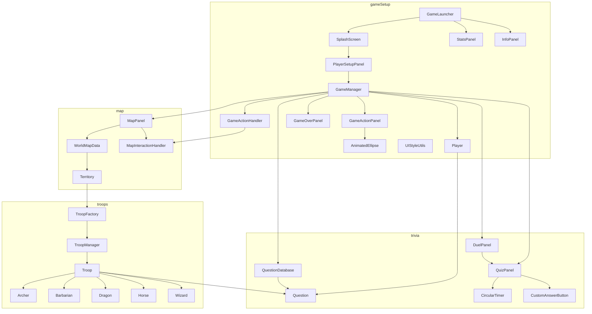

# Think-And-Conquer: Codebase Wiki

> Map of the sources in `src/` (30 Java files, about 14,800 lines, of which about 5,900 are
> the question database). It helps you see at a glance which file you are looking at, what
> each one does and who depends on whom.
> Last updated: 25 Oct 2026.

Think-And-Conquer is a turn-based game for **2 to 4 players** inspired by Risk, written in
**Java with Swing/AWT** and no external libraries. Players conquer territories on a world map,
but battles are not decided by dice: they are decided by **general knowledge questions**.
It is Renato's **first Java project**.

---

## 1. How to run

Requires a JDK **22 or later** (the code uses the unnamed variable `_` in lambdas). The working
directory must be the project root, because images and fonts are loaded with relative
`resources/...` paths.

```
javac -d out -sourcepath src src/gameSetup/GameLauncher.java
java -cp out gameSetup.GameLauncher
```

In VS Code: open the `Think-And-Conquer` folder itself and use Run on `GameLauncher.main`.

Entry point: `gameSetup.GameLauncher`. Screen flow:

```
SplashScreen (Enter) -> PlayerSetupPanel (names, colours, number of players)
   -> game screen (MapPanel + GameActionPanel + StatsPanel + InfoPanel)
   -> GameOverPanel (ranking and winner statistics)
```

---

## 2. Game rules (as implemented)

| Rule | Value | Where |
|---|---|---|
| Players | 2 to 4 | `PlayerSetupPanel` |
| Starting territories | 3 each, all in the same randomly chosen continent | `GameManager.assignInitialTerritories` |
| Starting troops | 1 on each territory + 2 to deploy | `GameManager.initializeGame` |
| Points per conquered territory | 100 | `TERRITORY_POINTS` |
| Full continent bonus | 200 (lost if control is lost) | `CONTINENT_BONUS`, `checkContinentBonus/Loss` |
| Reinforcements at turn start | `max(1, points / 200)` random troops | `assignReinforcements` |
| Points needed to win | 3600 with 2 players, 3200 with 3, 2800 with 4 | `calculateMaxPoints` |
| Other victory condition | being the last player left | `checkVictory` |
| Map | 36 territories in 9 regions of 4 territories | `WorldMapData` |

The 9 regions: Europe, Africa, North America, Central America, South America, North Asia,
South-East Asia, West Asia, Oceania.

### Troops and categories
Each troop type is tied to a question category:

| Troop | Category |
|---|---|
| Archer | Literature and Art |
| Barbarian | History and Geography |
| Dragon | Movies and Music |
| Horse | Sport |
| Wizard | Science |

When a troop fights, the questions come from its category. Choosing which troops to attack
with means choosing which topics the battle is played on.

### The actions of a turn
- **Deploy**: place new troops on one of your own territories.
- **Move**: move troops between neighbouring territories you own.
- **Attack**: attack a neighbouring enemy territory. Each troop acts once per turn
  (`Territory.markTroopAsActed`).

### How an attack is resolved
1. **Undefended territory**: a single question from the category of the most numerous
   attacking troop type. Difficulty depends on the troops used: up to 2 troops gives
   difficulty 3, 3 or 4 troops gives difficulty 2, 5 or more gives difficulty 1. A correct
   answer conquers the territory; a wrong one marks the troops as used but they are not lost.
2. **Defended territory**: a **duel** opens (`DuelPanel`). Each troop generates one question.
   Attacker and defender alternate; on each turn the player chooses the difficulty (1 to 5,
   with 10 seconds to choose). A correct answer is worth `difficulty x 100` points.
3. **Outcome** (`GameManager.resolveBattleResults`): whoever has more duel points wins. The
   loser loses all the troops involved. The winner loses some depending on how much they
   dominated: `survival = clamp(0.2 + 0.4 x dominance, 0.3, 0.8)` with
   `dominance = (W - L) / (W + L)`. Surviving troops are picked at random.
   A 0-0 draw: both sides lose everything and the defender keeps the territory. Any other
   draw: both sides are reduced to the lower troop count.

Each question has 20 seconds (`QuizPanel`, with an animated circular timer).

---

## 3. Layered architecture

| Layer | What it does | Main files |
|---|---|---|
| **Startup and UI flow** | Window, screens, scaling, shortcuts | `GameLauncher`, `SplashScreen`, `PlayerSetupPanel`, `GameOverPanel` |
| **Game logic** | Turns, actions, points, battles, victory | `GameManager`, `GameActionHandler`, `Player` |
| **Map** | Territory data and map drawing/clicks | `Territory`, `WorldMapData`, `MapPanel`, `MapInteractionHandler` |
| **Troops** | Troop types and icons | `Troop`, `Archer`, `Barbarian`, `Dragon`, `Horse`, `Wizard`, `TroopManager`, `TroopFactory` |
| **Trivia** | Questions, quizzes and duels | `Question`, `QuestionDatabase`, `QuizPanel`, `DuelPanel`, `CircularTimer`, `CustomAnswerButton` |
| **Support panels** | Player actions, statistics, help | `GameActionPanel`, `StatsPanel`, `InfoPanel`, `AnimatedEllipse` |
| **Style** | Shared colours, fonts, icons | `UIStyleUtils` |

Packages: `gameSetup`, `map`, `troops`, `trivia`.

---

## 4. Dependency graph



All screens use `UIStyleUtils` for colours, fonts and icons.

---

## 5. File by file

### Package `gameSetup`

**`GameLauncher`** (466 lines). Entry point. Creates the `JFrame`, applies the system look and
feel, handles shortcuts (full screen, statistics, help) and the menu, and shows the splash.

**`SplashScreen`**. Opening screen with blinking text; Enter goes to the setup.

**`PlayerSetupPanel`** (722 lines). Choice of the number of players (2 to 4), names and colours.
Validates the names and calls `startGame()`, which creates the `Player` objects, the
`GameManager` and the map.

**`GameManager`** (1131 lines). The most important class: holds the game state and all the
rules. Key methods: `initializeGame`, `nextTurn`, `deployTroops`, `prepareMoveWithTroops`,
`prepareAttackWithTroops`, `completeAttack`, `resolveBattleResults`, `checkVictory`,
`checkContinentBonus/Loss`. Uses an enum `ActionType {NONE, ATTACK, MOVE}`.

**`GameActionHandler`**. Mediator between interface and logic: translates map clicks into calls
to `GameManager` and provides the valid targets for attack and move.

**`GameActionPanel`** (844 lines). Control panel: action buttons, an end-turn control, an
overlay to choose troops, and the animated turn-change notification.

**`Player`**. Name, colour, points, available troops and statistics (correct and wrong answers
per category). Has `eliminated` and `winner` flags.

**`StatsPanel`**. Statistics for all players, refreshed during play. Meant for planning strategy.

**`InfoPanel`**. Help page with the rules, in English or Italian (two language buttons).

**`GameOverPanel`**. Winner, ranking and detailed winner statistics, with options to restart or exit.

**`AnimatedEllipse`**. Animated ellipse with text, run on a separate thread (used for notifications).

**`UIStyleUtils`**. Style constants (colours, fonts, icons) and methods to create uniform
labels and buttons. Loads resources from `resources/`.

### Package `map`

**`Territory`**. A territory: name, continent, owner, neighbours, troops by type. Tracks which
troops have already acted in the current turn.

**`WorldMapData`**. Builds the 36 territories, their borders (`setupNeighbors`) and the
grouping by continent. Keeps data separate from drawing.

**`MapPanel`** (882 lines). Draws the map and handles clicks using **colour-based hit
detection**: besides the visible map there is a hidden image (`worldMapClickDetection.png`) in
which every territory has a unique colour. On a click the pixel colour is read and mapped back
to the territory (with some tolerance on the colour). In the file's own header Renato says
part of the click-detection methods were not written entirely by him but that he understood them.

**`MapInteractionHandler`**. Interaction state: selected territory, current action, cursor,
highlighting and blinking of valid targets.

### Package `troops`

**`Troop`** (abstract): name, category, icon. The five subclasses (`Archer`, `Barbarian`,
`Dragon`, `Horse`, `Wizard`) are one-liners that only pass data. **`TroopManager`**: static
registry of the types and icon cache. **`TroopFactory`**: a simple facade over `TroopManager`.

### Package `trivia`

**`Question`**: text, correct answer, shuffled options, category, difficulty from 1 to 5
("Too Easy" to "Impossible", worth `difficulty x 100` points).
**`QuestionDatabase`** (5890 lines): about **1,150 questions** written in the source, in five
methods, one per category. `getRandomQuestion(category, difficulty)` picks one at random.
**`QuizPanel`**: shows a question with a 20 second timer, four answers and keyboard shortcuts.
**`DuelPanel`**: runs the turn-based duel with difficulty choice, feedback and final result.
**`CircularTimer`**: animated circular timer. **`CustomAnswerButton`**: answer button with
lockable colours.

---

## 6. Folder layout

```
Think-And-Conquer/
  src/
    gameSetup/   troops/   map/   trivia/
  resources/
    fonts/       # EB Garamond fonts
    images/      # splash, map, click-detection map, troop icons
      territories/   # 252 images for the territories
  docs/CODEBASE.md
```
